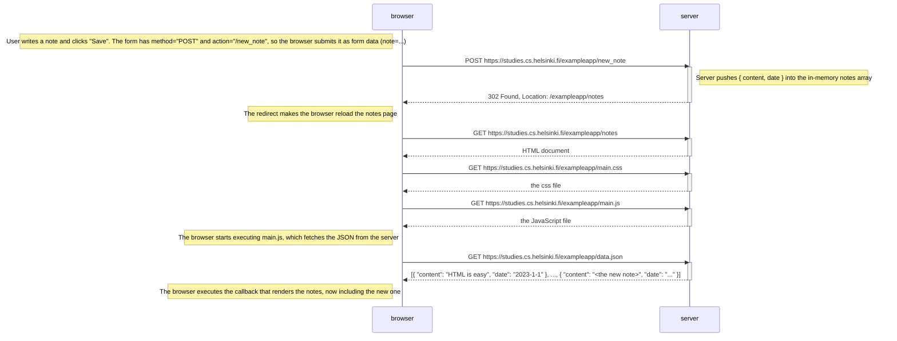

# 0.4: New note diagram

The user is on https://studies.cs.helsinki.fi/exampleapp/notes, writes a note into the text field and clicks **Save**.

In total the form submit causes five HTTP requests: one POST and, after the redirect, four GETs.
