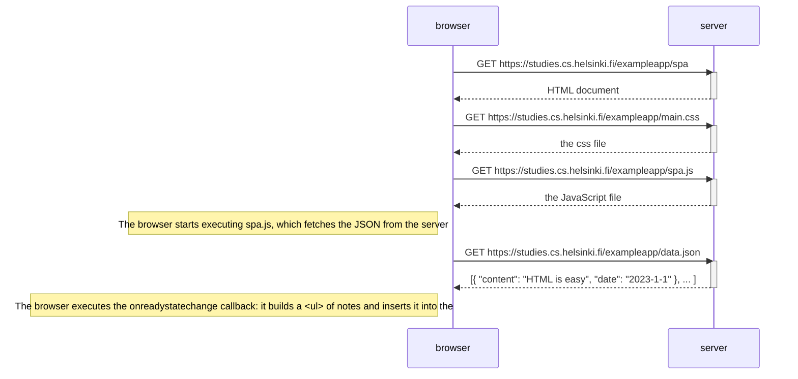

# 0.5: Single page app diagram

The user opens https://studies.cs.helsinki.fi/exampleapp/spa.

The HTML is almost identical to the traditional notes page, but the form has no `action` or `method` attributes and the script is `spa.js` instead of `main.js`.
