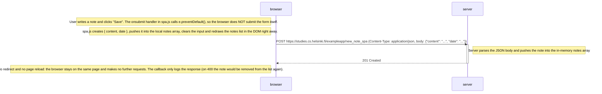

# 0.6: New note in Single page app diagram

The user is on https://studies.cs.helsinki.fi/exampleapp/spa, writes a note and clicks **Save**.

Compared to the traditional app, creating a note costs a single HTTP request instead of five, and the page is never reloaded.
