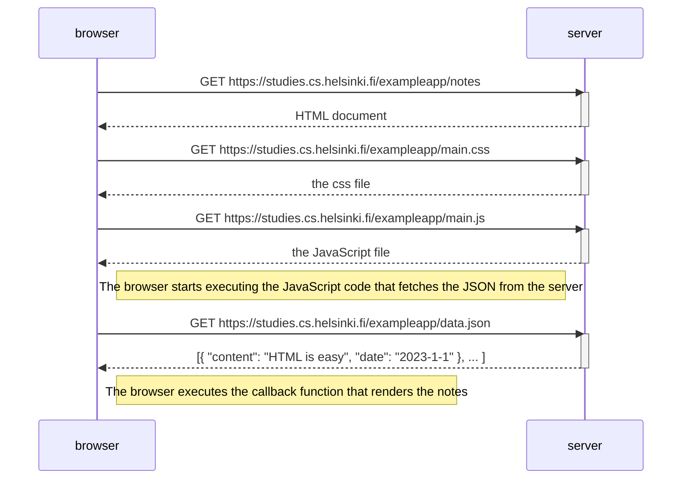

# Full Stack Open — Part 0b. Основы веб-приложений. Конспект

Конспект по главе https://fullstackopen.com/en/part0/fundamentals_of_web_apps.
Учебное приложение, на котором всё разбирается: https://studies.cs.helsinki.fi/exampleapp/
Блоки «Сверх программы» — то, чего в главе нет, но что полезно знать и попробовать.

---

## 0. Зачем эта глава

Прежде чем писать React и Node, нужно понять, что на самом деле происходит между браузером и сервером, когда вы открываете страницу или нажимаете кнопку. Вся глава построена вокруг одного приёма: открыть DevTools (инструменты разработчика), вкладку Network, и смотреть на реальные запросы. Это главный навык, который нужно унести отсюда.

**Как открыть DevTools:** F12 или Ctrl+Shift+I (Windows/Linux), Cmd+Option+I (macOS). Правой кнопкой по странице → «Просмотреть код» (Inspect).

Вкладки, которые используются в главе:

| Вкладка | Для чего |
|---|---|
| Network | Список всех HTTP-запросов страницы: URL, метод, статус, размер, время, заголовки, тело ответа |
| Console | Выполнять JavaScript прямо на странице, смотреть `console.log` и ошибки |
| Elements | Живое дерево DOM и стили CSS, можно править на лету |

Важные флажки на вкладке Network: **Disable cache** (не брать файлы из кеша, чтобы видеть все запросы) и **Preserve log** (не очищать список при переходе на другую страницу, иначе при редиректе часть запросов исчезнет).

---

## 1. HTTP и запрос GET

### Определения

- **HTTP (HyperText Transfer Protocol)** — протокол, по которому браузер и сервер обмениваются сообщениями. Простыми словами: формат «письма», которое браузер шлёт серверу, и формат «ответа». Всё в вебе работает поверх него.
- **Запрос (request)** — сообщение от браузера серверу. Состоит из метода, URL, заголовков и (иногда) тела.
- **Ответ (response)** — сообщение от сервера браузеру. Состоит из кода состояния, заголовков и тела.
- **Метод GET** — «дай мне ресурс». Используется, когда браузер хочет получить страницу, картинку, файл стилей. GET не должен ничего менять на сервере.
- **Код состояния (status code)** — трёхзначное число в ответе. `200 OK` — всё хорошо.
- **Заголовки (headers)** — пары «ключ: значение» с метаданными. Самый важный в главе — `Content-Type`.

### Что показывает глава

Открываем `https://studies.cs.helsinki.fi/exampleapp/` при включённой вкладке Network. Видим два запроса:

1. GET на сам адрес — сервер отвечает HTML-документом.
2. GET на `kuva.png` — картинка, на которую ссылается тег `` внутри HTML.

Порядок важен: браузер получил HTML, начал его разбирать, встретил `` и **только тогда** отправил второй запрос. Браузер может начать рисовать страницу ещё до того, как картинка догрузилась.

Заголовки ответа, на которые смотрим:

- `Content-Type: text/html; charset=utf-8` — говорит браузеру «это HTML, отрисуй как страницу».
- `Content-Type: image/png` — «это картинка PNG».

HTML главной страницы генерируется сервером **динамически**: в неё подставляется число заметок. На сервере это функция вроде `getFrontPageHtml(noteCount)`, которая возвращает строку с HTML (шаблонная строка JavaScript).

### Сверх программы

- **Другие методы HTTP:** `POST` (создать / отправить данные), `PUT` (заменить целиком), `PATCH` (изменить частично), `DELETE` (удалить), `HEAD` (как GET, но без тела — только заголовки), `OPTIONS` (что разрешено, используется в CORS).
- **Классы кодов состояния:** 1xx информационные, 2xx успех (`200`, `201 Created`, `204 No Content`), 3xx перенаправление (`301` постоянное, `302` временное, `304 Not Modified` — бери из кеша), 4xx ошибка клиента (`400 Bad Request`, `401 Unauthorized`, `403 Forbidden`, `404 Not Found`, `429 Too Many Requests`), 5xx ошибка сервера (`500`, `502`, `503`).
- **Полезные заголовки:** `Cache-Control` (как долго кешировать), `Set-Cookie` / `Cookie` (сессии), `Authorization` (токены), `Accept` (какой формат ответа хочет клиент), `Location` (куда редиректить).
- **Запросы без браузера:** `curl -i https://studies.cs.helsinki.fi/exampleapp/` покажет заголовки и тело прямо в терминале. В DevTools любой запрос можно скопировать правой кнопкой → Copy → Copy as cURL и воспроизвести из консоли.
- **Инструменты для API:** Postman, Insomnia, HTTPie, встроенный REST-клиент в IntelliJ IDEA (`.http` файлы).
- **Фильтры во вкладке Network:** кнопки Fetch/XHR, JS, CSS, Img, Doc. Поле фильтра понимает `status-code:302`, `method:POST`, `larger-than:100k`.
- **Throttling:** в Network можно эмулировать медленный 3G и увидеть, как страница ведёт себя на плохой сети.

---

## 2. Традиционные веб-приложения

### Суть

В «старой» модели браузер — глупый терминал. Он умеет только запросить HTML и показать его. Вся **логика приложения** (что показать, какие данные достать, что посчитать) живёт на сервере. Каждое действие пользователя = новый запрос = новая страница целиком.

HTML может быть:

- **статическим** — лежит файлом на диске, сервер отдаёт как есть;
- **динамическим** — сервер собирает HTML на лету, подставляя данные (как число заметок на главной).

В главе сервер написан на **Express** (фреймворк для **Node.js** — среды, позволяющей запускать JavaScript вне браузера). Упоминаются аналоги: Java Spring, Python Flask, Ruby on Rails. Генерация HTML строками — приём эпохи PHP.

### Термины простыми словами

- **Сервер** — программа (и машина), которая слушает запросы и отвечает на них.
- **Фреймворк** — набор готовых инструментов, задающий структуру приложения, чтобы не писать всё с нуля.
- **Шаблон (template)** — HTML с «дырками», куда подставляются данные.

### Сверх программы

- Современные шаблонизаторы на сервере: EJS, Pug, Handlebars (Node), Thymeleaf (Spring), Jinja2 (Flask/Django).
- Этот подход не умер: **SSR (server-side rendering)** вернулся в моде через Next.js, Remix, Astro — HTML собирается на сервере, а JavaScript «оживляет» его в браузере (hydration). Для SEO и скорости первого показа это лучше чистого SPA.
- **HTMX** — библиотека, которая делает традиционную модель «сервер отдаёт HTML» интерактивной без написания JavaScript.

---

## 3. Выполнение логики в браузере

### Что происходит на странице `/notes`

При открытии `https://studies.cs.helsinki.fi/exampleapp/notes` браузер делает **четыре** запроса:

1. `GET /notes` → HTML-документ. В нём **нет** самих заметок, только каркас.
2. `GET /main.css` → стили (ссылка в `<link rel="stylesheet">`).
3. `GET /main.js` → скрипт (тег `<script src="main.js">` в `<head>`).
4. `GET /data.json` → сами заметки в формате JSON. Этот запрос делает уже **JavaScript**, а не HTML.

Код `main.js` из главы:

```js
var xhttp = new XMLHttpRequest()

xhttp.onreadystatechange = function() {
  if (this.readyState == 4 && this.status == 200) {
    const data = JSON.parse(this.responseText)
    console.log(data)
    // ...построение списка в DOM...
  }
}

xhttp.open('GET', '/data.json', true)
xhttp.send()
```

### Термины

- **JSON (JavaScript Object Notation)** — текстовый формат данных, выглядит как объект JavaScript: `[{ "content": "HTML is easy", "date": "2023-1-1" }]`. Универсальный язык обмена между фронтендом и бэкендом.
- **`JSON.parse(text)`** — превращает строку JSON в объект JavaScript. Обратное — `JSON.stringify(obj)`.
- **`XMLHttpRequest` (XHR)** — старый встроенный объект браузера для отправки HTTP-запросов из JavaScript. В главе он выбран намеренно: современный `fetch` возвращает промисы, которые разберут позже.
- **`console.log(...)`** — вывод в консоль DevTools. Самый быстрый способ отладки. `clear()` в консоли очищает её.
- **JSONView** — расширение для браузера, которое красиво форматирует JSON, если открыть `data.json` напрямую.

### Сверх программы

- **`fetch`** — современная замена XHR:
  ```js
  fetch('/data.json')
    .then(res => res.json())
    .then(data => console.log(data))
  ```
  или с `async/await`:
  ```js
  const res = await fetch('/data.json')
  const data = await res.json()
  ```
- В консоли DevTools можно писать `await fetch(...)` прямо, без обёртки в функцию.
- `console` умеет больше, чем `log`: `console.table(data)` покажет массив объектов таблицей, `console.error`, `console.warn`, `console.group`, `console.time('x')` / `console.timeEnd('x')` для замера времени.
- На вкладке Network у запроса `data.json` есть подвкладка **Preview** — она тоже форматирует JSON, расширение не обязательно.
- Вкладка **Sources** позволяет ставить точки останова (breakpoints) в `main.js` и смотреть переменные пошагово — куда мощнее `console.log`.

---

## 4. Обработчики событий и функции обратного вызова

### Определения

- **Событие (event)** — что-то произошло: пользователь кликнул, страница загрузилась, пришёл ответ сервера, изменилось состояние запроса.
- **Обработчик события (event handler)** — функция, которую вы «вешаете» на событие. Браузер вызовет её сам, когда событие случится.
- **Функция обратного вызова (callback)** — функция, которую вы передаёте куда-то, чтобы её вызвали позже. Обработчик события — частный случай callback.

Ключевая мысль главы: ваш код **не вызывает** `onreadystatechange` сам. Вы только регистрируете функцию, а вызывает её среда выполнения (браузер), когда придёт время. Это принципиально иной стиль мышления по сравнению с последовательным «строчка за строчкой».

Проверка внутри обработчика:

- `this.readyState == 4` — запрос завершён (состояния: 0 не инициализирован, 1 открыт, 2 заголовки получены, 3 загрузка, 4 готово).
- `this.status == 200` — сервер ответил успехом.

### Сверх программы

- `addEventListener('click', fn)` — современный способ повесить обработчик, можно навесить несколько на одно событие, в отличие от `element.onclick = fn`.
- Объект события `e` содержит массу полезного: `e.target` (кто вызвал), `e.key` (какая клавиша), `e.clientX/Y` (координаты), `e.preventDefault()` (отменить стандартное действие), `e.stopPropagation()` (не всплывать выше).
- **Всплытие (bubbling)** — событие идёт от самого вложенного элемента вверх по дереву. На этом строится **делегирование**: один обработчик на `<ul>` ловит клики по всем `<li>`.
- Асинхронность в JavaScript — это **цикл событий (event loop)**: один поток, очередь задач. Поэтому долгий синхронный код «вешает» страницу. Хорошее видео: «What the heck is the event loop anyway?» (Philip Roberts).
- Эволюция callback → **Promise** → **async/await** — именно чтобы избежать «ада обратных вызовов» (callback hell), когда вложенность растёт.

---

## 5. DOM — объектная модель документа

### Определения

- **DOM (Document Object Model)** — представление HTML-страницы в виде дерева объектов в памяти браузера. Простыми словами: HTML — это текст, DOM — это «живая» структура, которую можно трогать из JavaScript.
- **Узел (node), элемент (element)** — вершины дерева: `html` → `head`, `body` → `div` → `ul` → `li` и так далее. Текст внутри тега — тоже узел (текстовый).
- **DOM API** — набор методов для чтения и изменения этого дерева.

### Код из главы (так `main.js` рисует заметки)

```js
const ul = document.createElement('ul')

data.forEach(function(note) {
  const li = document.createElement('li')
  ul.appendChild(li)
  li.appendChild(document.createTextNode(note.content))
})

document.getElementById('notes').appendChild(ul)
```

Разбор:

- `document` — корневой объект страницы.
- `document.createElement('ul')` — создать элемент (пока он «висит в воздухе», не на странице).
- `appendChild(child)` — вставить как последнего ребёнка.
- `document.createTextNode(text)` — создать текстовый узел.
- `document.getElementById('notes')` — найти элемент по атрибуту `id="notes"`.

Вкладка Elements в DevTools показывает ровно это дерево, причём **актуальное**, с учётом всех изменений JavaScript, а не исходный HTML (его можно увидеть через «Просмотр кода страницы», Ctrl+U).

### Сверх программы

- Поиск элементов современным способом: `document.querySelector('.notes li')` (первый по CSS-селектору), `document.querySelectorAll('li')` (все). Это удобнее `getElementsByTagName`.
- `element.textContent = '...'` безопаснее, чем `innerHTML = '...'`: `innerHTML` вставляет HTML и открывает дверь XSS-атакам, если в данных есть пользовательский ввод.
- `element.remove()`, `element.replaceWith()`, `element.insertAdjacentHTML()`, `element.classList.add/remove/toggle()`, `element.dataset.xxx` (атрибуты `data-xxx`).
- `document.createDocumentFragment()` — собрать много элементов «за кадром» и вставить одним махом, чтобы страница не перерисовывалась на каждый `appendChild`.
- **MutationObserver** — следить за изменениями DOM. **IntersectionObserver** — узнать, когда элемент попал в зону видимости (ленивая подгрузка картинок, бесконечная лента).
- В Elements правой кнопкой по узлу → Break on → subtree modifications: отладчик остановится, когда какой-то скрипт тронет этот узел. Отличный способ найти, кто меняет страницу.
- React, который начнётся в части 1, по сути автоматизирует ровно этот ручной `createElement`/`appendChild`, отслеживая, что нужно обновить.

---

## 6. Манипуляции с DOM из консоли

В консоли DevTools можно делать то же самое вручную:

```js
document                                   // весь документ
list = document.getElementsByTagName('ul')[0]
newElement = document.createElement('li')
newElement.textContent = 'Page manipulation from console is easy'
list.appendChild(newElement)
```

Новая строка тут же появится на странице. Но после перезагрузки (F5) она исчезнет: изменение было только в памяти браузера, сервер о нём ничего не знает.

Вывод: **то, что видит пользователь, и то, что хранит сервер, — разные вещи.** Чтобы данные сохранились, их нужно отправить на сервер.

### Сверх программы

- В консоли есть сокращения: `$('.notes')` = `querySelector`, `$$('li')` = `querySelectorAll`, `$0` — элемент, выбранный сейчас во вкладке Elements, `$_` — результат последнего выражения.
- `copy(obj)` скопирует объект в буфер обмена как JSON.
- `monitorEvents($0, 'click')` будет логировать клики по выбранному элементу.
- Любой пользователь может так же менять страницу у себя в браузере. Поэтому **нельзя доверять данным с клиента**: цену, права, валидацию сервер обязан проверять сам.

---

## 7. CSS

### Определения

- **CSS (Cascading Style Sheets)** — язык описания внешнего вида: цвета, отступы, рамки, шрифты, расположение.
- **Селектор** — «кому применить правило». Селектор класса начинается с точки: `.container`. Селектор id начинается с решётки: `#notes`. Селектор тега — просто имя: `ul`.
- **Каскад** — если несколько правил подходят к одному элементу, побеждает более специфичное или более позднее.

Файл `main.css` подключён в `<head>` через `<link rel="stylesheet" type="text/css" href="main.css">`.

```css
.container {
  padding: 10px;
  border: 1px solid;
}

.notes {
  color: blue;
}
```

`.container` получает внутренний отступ 10 px и рамку 1 px. `.notes` — синий текст.

Разница атрибутов: `class` используется в основном для стилей и может повторяться; `id` уникален на странице и в главе нужен JavaScript, чтобы найти элемент (`getElementById('notes')`).

Во вкладке Elements справа видны стили выбранного элемента, их можно править на лету. Как и правки DOM из консоли, это временно и пропадёт после перезагрузки.

### Сверх программы

- **Блочная модель (box model):** content → padding → border → margin. В Elements есть её наглядная схема. `box-sizing: border-box` делает ширину «понятной» (включает padding и border).
- **Flexbox** (`display: flex`) и **Grid** (`display: grid`) — современные механизмы раскладки. Их стоит выучить сразу, старые приёмы с `float` уже не нужны. Игры-тренажёры: Flexbox Froggy, Grid Garden.
- **CSS-переменные:** `:root { --brand: #1E4ED8 } .btn { color: var(--brand) }`.
- **Медиазапросы** для мобильных: `@media (max-width: 600px) { ... }`. В DevTools есть режим эмуляции устройств (Ctrl+Shift+M).
- **Псевдоклассы:** `:hover`, `:focus`, `:nth-child(2n)`, `:not(...)`. В Elements можно принудительно включить состояние `:hov`, чтобы увидеть стиль наведения.
- Вкладка **Computed** показывает итоговое значение каждого свойства после каскада и откуда оно пришло.
- Дальше по курсу: Tailwind CSS (утилитарные классы), CSS-модули, styled-components — разные способы не дать стилям разных компонентов конфликтовать.

---

## 8. Загрузка страницы с JavaScript — сводка

Полная цепочка при открытии `/notes`:

1. Браузер → сервер: `GET /notes`. Сервер → HTML.
2. Браузер разбирает HTML, видит `<link>` и `<script>`, запрашивает `main.css` и `main.js`.
3. Браузер исполняет `main.js`. Скрипт отправляет `GET /data.json`.
4. Сервер отдаёт JSON с заметками.
5. Срабатывает обработчик `onreadystatechange`, который через DOM API строит `<ul>` с `<li>` и вставляет в `#notes`.

Диаграмма из главы (Mermaid):



### Сверх программы

- **Mermaid** умеет не только sequence-диаграммы: `flowchart`, `classDiagram`, `erDiagram` (схемы БД), `gantt`, `stateDiagram`. GitHub, GitLab, Obsidian, Notion рендерят их из обычного Markdown. Онлайн-редактор: mermaid.live.
- Порядок загрузки можно менять атрибутами `<script defer>` (выполнить после разбора HTML) и `<script async>` (как только скачается). Без них скрипт в `<head>` **блокирует** разбор страницы.
- Вкладка Network → подвкладка **Timing** у запроса показывает фазы: DNS, подключение, TLS, ожидание ответа (TTFB), скачивание. Колонка **Waterfall** показывает, что шло параллельно, а что ждало.
- **Lighthouse** (вкладка в DevTools) измерит скорость загрузки и даст советы.

---

## 9. Формы и HTTP POST

### Что происходит

На странице `/notes` есть форма:

```html
<form action="/new_note" method="POST">
  <input type="text" name="note"><br>
  <input type="submit" value="Save">
</form>
```

- `method="POST"` — отправить данные, а не запросить.
- `action="/new_note"` — куда отправить.
- `name="note"` — под каким ключом полетит значение поля.

При нажатии Save браузер сам (без JavaScript) делает `POST /new_note` с телом `note=текст` (формат `application/x-www-form-urlencoded`). Во вкладке Network это видно в подвкладке **Payload** (Form Data).

Сервер (Express):

```js
app.post('/new_note', (req, res) => {
  notes.push({
    content: req.body.note,
    date: new Date(),
  })

  return res.redirect('/notes')
})
```

Он кладёт заметку в массив `notes` **в памяти** (никакой базы данных, после перезапуска сервера всё пропадёт) и отвечает **`302 Found`** с заголовком `Location: /notes`.

**302** — это **редирект**: «иди на другой адрес». Браузер послушно делает `GET /notes`, а дальше всё как в разделе 8. Итого одно нажатие кнопки = **пять** запросов: POST + HTML + CSS + JS + JSON.

Этот приём называется **PRG (Post/Redirect/Get)**: благодаря редиректу обновление страницы (F5) не отправляет форму повторно.

### Сверх программы

- Атрибуты валидации прямо в HTML, без JavaScript: `required`, `minlength`, `maxlength`, `pattern`, `type="email"`, `type="number"`, `min`, `max`. Браузер сам не даст отправить пустое или неверное поле.
- Для мобильных: `inputmode="decimal"`, `autocomplete="email"`, `enterkeyhint="send"` — управляют клавиатурой и автозаполнением.
- `enctype="multipart/form-data"` нужен, чтобы отправить файл (`<input type="file">`).
- Объект **`FormData`** в JavaScript: `new FormData(form)` собирает все поля формы; его можно отправить через `fetch` или превратить в объект: `Object.fromEntries(new FormData(form))`.
- Разница 301 и 302: 301 — «навсегда переехал», браузер и поисковики запоминают; 302 — «временно», каждый раз спрашивают заново. Есть ещё 303 See Other (явно «сделай GET») и 307/308 (сохранить метод).
- Всё, что сервер кладёт в память, теряется при перезапуске — поэтому в части 3 появится MongoDB, а в реальных проектах PostgreSQL и прочие базы.

---

## 10. AJAX

### Определение

- **AJAX (Asynchronous JavaScript and XML)** — подход, при котором страница подгружает данные с сервера с помощью JavaScript **без полной перезагрузки**. Термин появился в феврале 2005 года. Слово XML в названии историческое: сегодня почти всегда передают JSON.

Страница `/notes` — гибрид: заметки она **получает** по-AJAX-овски (`data.json` через XHR), а **добавляет** по-старому (отправка формы и редирект). Это стиль начала 2000-х. Сам термин AJAX сейчас почти не употребляют, потому что это стало нормой, а не фишкой.

Глава замечает, что адреса `data.json` и `new_note` не следуют соглашениям **REST** (об этом в части 3): в REST адреса обозначают ресурсы (`/notes`), а действие задаётся методом (`GET /notes` — список, `POST /notes` — создать, `DELETE /notes/5` — удалить пятую).

### Сверх программы

- Инструменты для «живых» данных помимо запрос-ответ: **WebSocket** (двусторонний канал, чаты, игры), **Server-Sent Events** (сервер пушит события в одну сторону, прост в реализации), **long polling** (старый приём «держать запрос открытым»).
- **GraphQL** — альтернатива REST, где клиент сам описывает, какие поля ему нужны (будет в части 8 курса).
- **CORS** — браузер не даст JavaScript с одного домена дёргать API другого домена, пока сервер не разрешит заголовком `Access-Control-Allow-Origin`. Первая ошибка, на которую натыкаются все, кто начинает писать фронтенд отдельно от бэкенда.
- Для надёжности запросов: таймауты (`AbortController`), повторные попытки, показ индикатора загрузки, обработка ошибок сети, а не только `status == 200`.

---

## 11. Одностраничное приложение (SPA)

### Определение

- **SPA (Single Page Application)** — приложение из **одной** HTML-страницы, которая загружается один раз, а дальше весь интерфейс перерисовывает JavaScript, общаясь с сервером только за данными. Примеры из жизни: Gmail, Google Maps, любой современный веб-интерфейс.

Версия приложения: `https://studies.cs.helsinki.fi/exampleapp/spa`. Отличия от `/notes`:

- Форма **без** `action` и `method` — браузер не знает, куда её слать, и слать не будет.
- Скрипт `spa.js` вместо `main.js`.

Ключевой код `spa.js`:

```js
form.onsubmit = function(e) {
  e.preventDefault()                      // отменить стандартную отправку формы

  var note = {
    content: e.target.elements[0].value,
    date: new Date()
  }

  notes.push(note)                        // добавить в локальный массив
  e.target.elements[0].value = ''         // очистить поле
  redrawNotes()                           // перерисовать список в DOM
  sendToServer(note)                      // и отправить на сервер
}

var sendToServer = function(note) {
  var xhttpForPost = new XMLHttpRequest()
  // ...
  xhttpForPost.open('POST', '/new_note_spa', true)
  xhttpForPost.setRequestHeader('Content-type', 'application/json')
  xhttpForPost.send(JSON.stringify(note))
}
```

Что видно в Network при добавлении заметки: **один** запрос `POST /new_note_spa`, в теле JSON, заголовок `Content-Type: application/json` (без него сервер не поймёт, как разобрать тело). Ответ **`201 Created`** — «ресурс создан». Никакого редиректа, никакой перезагрузки, страница остаётся на месте.

Обратите внимание на порядок: список обновляется **до** ответа сервера. Это называется **оптимистичным обновлением**: интерфейс не ждёт сеть. В реальном `spa.js` есть и откат: если сервер ответил `400`, заметка убирается из списка и показывается `alert`.

### Сверх программы

- Навигация в SPA без перезагрузки: **History API** (`history.pushState`) и событие `popstate` — так работает React Router. Адрес в строке меняется, запроса к серверу нет.
- Обратная сторона SPA: первая загрузка тяжёлая (весь JavaScript сразу), SEO сложнее, нужен fallback на сервере (любой путь отдаёт `index.html`). Решения: **code splitting** (грузить код по частям), **SSR/SSG** (Next.js, Astro), **PWA** (service worker, работа офлайн, установка на телефон).
- Сборщики: **Vite** (используется в курсе), Webpack, esbuild. Они превращают сотни файлов и `import` в один бандл.
- Оптимистичные обновления и кеширование запросов «из коробки» дают TanStack Query (React Query) и SWR.

---

## 12. Библиотеки JavaScript

Учебное приложение написано на **ванильном JavaScript** (vanilla JS — чистый язык плюс DOM API, без библиотек). В реальности почти всегда берут библиотеку.

| Библиотека | Роль по главе |
|---|---|
| **jQuery** | Герой традиционной эпохи. Главная ценность — сглаживала различия между браузерами. Сейчас браузеры стандартизированы, и нужда в ней отпала. |
| **BackboneJS** | Ранний фаворит для SPA. |
| **AngularJS** | Google, 2012. Стал де-факто стандартом. В октябре 2014 команда объявила, что Angular 2 не будет совместим с первой версией и поддержка 1.x закончится — популярность рухнула. Урок: ломающие изменения убивают доверие. |
| **React** | Facebook (Meta). Сейчас самая популярная библиотека для интерфейса, основа этого курса. Для управления состоянием в курсе используется **Zustand**. |
| **VueJS** | Более новый вариант, набирает интерес. |

Термины:

- **Библиотека** — набор функций, которые вы вызываете (React). **Фреймворк** — каркас, который вызывает ваш код (Angular). Граница условна.
- **Управление состоянием (state management)** — где хранить данные приложения и как уведомлять интерфейс об изменениях (Zustand, Redux).

### Сверх программы

- **Svelte / SvelteKit** — компилирует компоненты в чистый JavaScript без «виртуального DOM», очень маленькие бандлы. **SolidJS** — похожая идея с синтаксисом, близким к React. **Angular** (современный, без «JS» в названии) жив и популярен в enterprise.
- **Метафреймворки** поверх React: **Next.js**, **Remix** (теперь React Router v7), **Astro** (контентные сайты). Это то, что в индустрии чаще всего и используют вместо «голого» React.
- Как выбирать: State of JS (ежегодный опрос), npm trends, количество открытых issues и дата последнего релиза.
- **TypeScript** — JavaScript с типами, сейчас стандарт в индустрии; в курсе появится в части 9.

---

## 13. Full-stack разработка

### Определение

- **Full stack** — умение работать со всеми слоями приложения: **фронтенд** (браузер, то, что видит пользователь), **бэкенд** (сервер, логика, API) и **база данных**. Часто сюда же относят настройку и развёртывание (DevOps).

Раньше разработчики специализировались на одном слое. Теперь от full-stack ждут и навыков администрирования: выкатить в облако, настроить домен, сертификаты, мониторинг.

В курсе на всех слоях JavaScript: браузер + Node.js на сервере. Но это не обязательно: бэкенд может быть на Java, Python, Go, фронтенд всё равно будет на JavaScript (или TypeScript), потому что в браузере другого языка нет.

### Сверх программы

- Типичный современный стек: React/Next.js + Node (Express, Fastify, NestJS) или Spring Boot + PostgreSQL + Redis + Docker + CI (GitHub Actions) + хостинг (Fly.io, Render, Hetzner, Vercel). Части 11–12 курса как раз про CI/CD и контейнеры.
- **Слои не обязаны быть на одном языке.** Главное — договориться об **API-контракте** (OpenAPI/Swagger описывает, какие адреса, какие поля, какие ошибки).
- **BaaS (Backend as a Service)** — Firebase, Supabase: готовый бэкенд, чтобы быстро собрать прототип без своего сервера.

---

## 14. Усталость от JavaScript

Глава честно предупреждает: full-stack сложен.

- Отладка в браузере и на сервере сложнее, чем в настольных программах: запросы, сеть, асинхронность.
- Асинхронная модель JavaScript (обработчики, промисы) ломает привычное линейное мышление.
- Экосистема меняется очень быстро: новые инструменты каждый год, сотни способов сделать одно и то же. Это и называют **JavaScript fatigue** («усталость от JavaScript»).

Подход курса: начинать с кода, а не с настройки инструментов, чтобы не утонуть в конфигурации.

### Как с этим жить

- Не гнаться за всем новым. Выучить фундамент (HTTP, DOM, асинхронность, один фреймворк) — он не меняется десятилетиями.
- MDN (developer.mozilla.org) как основной справочник, а не случайные блоги.
- Один проект от начала до деплоя важнее десяти начатых туториалов.

---

## 15. Задания 0.1–0.6

- **0.1 HTML, 0.2 CSS, 0.3 HTML forms** — прочитать соответствующие учебники MDN. На GitHub не сдаются.
- **0.4** — диаграмма: пользователь на `/notes` пишет заметку и жмёт Save (POST → 302 → 4 GET).
- **0.5** — диаграмма: пользователь открывает `/spa` (HTML → CSS → spa.js → data.json).
- **0.6** — диаграмма: пользователь на `/spa` создаёт заметку (один POST JSON → 201, без редиректа).

Сдача: репозиторий на GitHub, папка `part0`, затем отметить выполненное во вкладке «my submissions» системы курса. Приватный репозиторий — добавить `mattiluukkainen` в соавторы. Части сдаются по одной, досдать пропущенное в сданной части нельзя.

Выполненные диаграммы лежат рядом с этим конспектом: `0.4_new_note.md`, `0.5_spa_load.md`, `0.6_spa_new_note.md`.

---

## 16. Шпаргалка терминов

| Термин | Простыми словами |
|---|---|
| HTTP | Правила переписки браузера и сервера |
| GET / POST | «Дай» / «Прими и сохрани» |
| Статус 200 / 201 / 302 / 404 / 500 | Ок / Создано / Иди по другому адресу / Не найдено / Сервер сломался |
| Заголовок | Служебная строка в запросе или ответе, например тип содержимого |
| Content-Type | Какого формата тело: HTML, JSON, картинка |
| Редирект | Сервер говорит браузеру «запроси другой адрес» |
| JSON | Текстовый формат данных, похожий на объект JavaScript |
| XHR / fetch | Способы отправить запрос из JavaScript |
| Событие / обработчик / callback | Что-то случилось / функция на этот случай / функция, которую вызовут позже |
| DOM | Дерево страницы в памяти браузера, которым управляет JavaScript |
| CSS / селектор | Внешний вид / «кому применить правило» |
| AJAX | Подгрузка данных без перезагрузки страницы |
| SPA | Одна страница, весь интерфейс рисует JavaScript |
| REST | Соглашение: адрес = ресурс, метод = действие |
| Библиотека / фреймворк | Вы вызываете её / она вызывает вас |
| Full stack | Фронт + бэк + база + развёртывание |
| Node.js / Express | JavaScript вне браузера / фреймворк для серверов на нём |
| Mermaid | Диаграммы текстом внутри Markdown |
